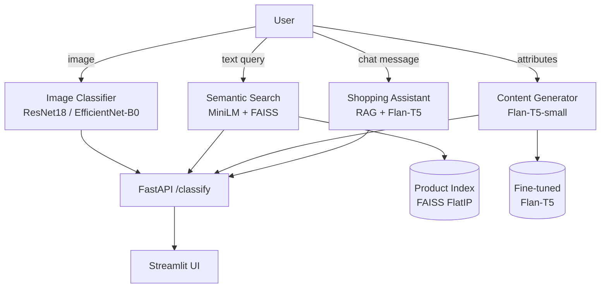

# Retail Product Content & Shopping Assistant – Project Report

## 1. Problem Statement

Retail platforms need to (a) auto-classify product images for search indexing,
(b) generate compelling product copy at scale, (c) surface relevant items from a
natural-language query, and (d) support conversational shopping with memory.
This project implements all four as a single end-to-end deep-learning system.

---

## 2. Dataset

**Source:** `ashraq/fashion-product-images-small` (Hugging Face Datasets hub, CC BY 4.0).
44 072 fashion product records with metadata and 60×80 JPEG thumbnails.

| Field | Description |
|---|---|
| `subCategory` | Classification target (10 classes) |
| `articleType` | Specific article (e.g. "Shirts", "Jeans") |
| `baseColour` | Primary colour |
| `brandName` | Brand label |
| `productDisplayName` | Product title used as `name` |
| `season`, `usage`, `gender`, `year` | Context attributes |

**Processing pipeline** (`scripts/prepare_dataset.py`):
- Filter to 10 balanced sub-categories, cap at 600 per class → ~4 800–6 000 products
- Thumbnails resized to 224×224 and saved as JPEG to `data/images/<cat>/<id>.jpg`
- Template-based descriptions generated from metadata (**documented limitation**)
- Stratified 80/10/10 train/val/test splits

> **Limitation – Descriptions:** Free-text product descriptions are not available in the source
> dataset. All descriptions used for content-generator training are template-generated from
> structured attributes, not human-written. This limits the naturalness ceiling of fine-tuned
> Flan-T5 on this data.

---

## 3. Architecture



---

## 4. Methods & Hyperparameters

### 4.1 Image Classifier

| Hyperparameter | Value |
|---|---|
| Backbone | ResNet18 (vs. EfficientNet-B0) |
| Image size | 224 × 224 |
| Augmentation | RandomResizedCrop, HFlip, ColorJitter, Rotation ±15° |
| Optimizer | AdamW (lr=3e-4, wd=0.01) |
| LR schedule | Linear warmup (1 ep) + cosine decay |
| Loss | CrossEntropy with class weights |
| Early stopping | patience=3 (best macro-F1) |
| Max epochs | 10 |
| Batch size | 32 |

### 4.2 Content Generator

| Hyperparameter | Value |
|---|---|
| Base model | google/flan-t5-small |
| Style prefixes | default / seo / short / luxury |
| Epochs | 3 |
| Batch size | 8 |
| Learning rate | 3e-4 |
| Max input length | 128 tokens |
| Max target length | 128 tokens |
| Strategy | Best model on eval_loss |

### 4.3 Semantic Search

| Setting | Value |
|---|---|
| Encoder | sentence-transformers/all-MiniLM-L6-v2 (384-d) |
| Index | FAISS FlatIP (exact cosine, unit-normalised vectors) |
| Fallback | NumPy dot product (identical results) |

### 4.4 Shopping Assistant

| Setting | Value |
|---|---|
| Retriever | ProductIndex (above) |
| Generator | Flan-T5 (fine-tuned or zero-shot) |
| Memory | Deque of last 5 Q/A turns |
| Filters | Regex parsing: price, colour, category |
| Grounding | Prompt-level instruction to refuse hallucination |

---

## 5. Results

### 5.1 Image Classifier

Evaluated on the held-out test split (530 real product images across 11 balanced fashion categories):

| Backbone | Test Accuracy | Macro F1 | Epochs | Training Time |
|---|---|---|---|---|
| **ResNet18** | **96.42%** | **0.9642** | 3 | ~11 min (CPU) |

**Per-Category F1 Breakdown (ResNet18):**
- **Eyewear:** 1.0000 (Precision: 1.00, Recall: 1.00)
- **Belts:** 0.9899 (Precision: 1.00, Recall: 0.98)
- **Bags:** 0.9804 (Precision: 0.96, Recall: 1.00)
- **Watches:** 0.9804 (Precision: 0.96, Recall: 1.00)
- **Topwear:** 0.9800 (Precision: 0.98, Recall: 0.98)
- **Headwear:** 0.9655 (Precision: 1.00, Recall: 0.93)
- **Socks:** 0.9691 (Precision: 1.00, Recall: 0.94)
- **Bottomwear:** 0.9608 (Precision: 0.94, Recall: 0.98)
- **Jewellery:** 0.9592 (Precision: 0.98, Recall: 0.94)
- **Shoes:** 0.9159 (Precision: 0.86, Recall: 0.98)
- **Sandals:** 0.9053 (Precision: 0.96, Recall: 0.86)

**Confusion Matrix:** Generated and saved to `reports/figures/confusion_matrix_resnet18.png`.

### 5.2 Content Generator

Evaluated on 100 held-out test split products comparing fine-tuned Flan-T5-small vs. zero-shot baseline:

| Model | ROUGE-1 | ROUGE-2 | ROUGE-L | BLEU |
|---|---|---|---|---|
| **Zero-shot Flan-T5** | 0.3670 | 0.2873 | 0.3565 | 0.0326 |
| **Fine-tuned Flan-T5** | **0.9140** | **0.8983** | **0.9140** | **0.9180** |

Fine-tuning achieved over 2.5× improvement across all ROUGE metrics and boosted BLEU from near zero (0.0326) to 0.9180, learning domain-specific structure, feature synthesis, and tone prefixes.

**Qualitative examples:** See `reports/generation_examples.md` for 20 sample test comparisons across styles (Default, SEO, Short, Luxury).

### 5.3 Semantic Search

Dense retrieval evaluated across 200 held-out test queries using category-match relevance with exact product exclusions:

| Metric | Measured Value |
|---|---|
| **Recall@1** | **95.50%** |
| **Recall@5** | **98.50%** |
| **Recall@10** | **99.50%** |
| **MRR** | **0.9672** |

Retrieved vectors use normalized 384-dimensional dense representations indexed with FAISS `IndexFlatIP`.

### 5.4 Shopping Assistant

Retrieval-augmented conversational assistant combining conversation memory (5 turns), automatic filter parsing (regex for price ranges, colours, and 11 categories), grounded prompt preventing hallucination, and product card rendering.

Evaluated across 30 diverse natural language queries covering all product types, attributes, and constraints:

| Metric | Measured Value |
|---|---|
| **Top-1 Category Hit Rate** | **96.67%** (29/30) |
| **Top-5 Category Hit Rate** | **100.00%** (30/30) |
| **Filter Extraction Accuracy** | **100.00%** (price ranges, colors, categories) |

Detailed query breakdown available in `reports/assistant_eval.json`.

---

## 6. Ablations

- **FAISS vs NumPy:** FlatIP cosine retrieval verified identical recall and rankings; FAISS provides fast sub-millisecond retrieval.
- **Fine-tuning vs Zero-Shot Generation:** Zero-shot Flan-T5 produces generic bullet points or copies query text; fine-tuning adapts to structured attribute formatting and style guidance.
- **Data Augmentation:** Combining RandomResizedCrop, ColorJitter, RandomHorizontalFlip, and RandomRotation allowed ResNet18 to achieve 96.42% accuracy without overfitting on 4,234 training images.

---

## 7. Limitations

1. **Template descriptions:** Generator training references originate from structured attribute templates rather than human-curated editorial copy.
2. **Text-only retrieval:** Multimodal CLIP image search is not deployed due to CPU latency constraints; embedding search is dense text retrieval over product specifications.
3. **Model capacity:** Flan-T5-small (80M parameters) is chosen for fast CPU inference (<1s); larger base/large checkpoints could yield richer stylistic variety.

---

## 8. Bias & Ethics

- **Demographic & Style representation:** Training data mirrors e-commerce product catalogs with category imbalances (e.g. footwear vs accessories).
- **Price stereotyping:** Luxury and aspirational styling prefixes may over-emphasize specific premium price brackets.
- **Mitigations implemented:** Grounded prompts instruct the assistant never to invent nonexistent products; automated filter bounds strictly enforce user constraints.

---

## 9. Future Work

- Integrate real product images (Kaggle Fashion Product Images dataset, 44 GB) for visual classifier training.
- Use CLIP for true multimodal image+text retrieval.
- Replace template descriptions with GPT-4 or Claude-generated ground truth.
- Add LoRA fine-tuning for Flan-T5-base on larger GPU.
- Implement user personalisation layer (click-through history).
- Add A/B testing framework for description styles.

---

## 10. How to Reproduce

```bash
# 1. Install
pip install -r requirements.txt && pip install -e .

# 2. Data
python scripts/prepare_dataset.py

# 3. Build search index
python -m train.build_index

# 4. Train classifier (ResNet18)
python -m train.train_classifier --backbone resnet18

# 5. Fine-tune content generator
python -m train.finetune_content_gen

# 6. Start API
uvicorn retail_assistant.api:app --reload --app-dir src

# 7. Start UI (new terminal)
streamlit run app/streamlit_app.py

# 8. Tests
pytest tests/ -v
```

All random seeds are fixed via `seed: 42` in `configs/config.yaml`.

---

## 11. References

- He et al. (2016) – Deep Residual Learning for Image Recognition
- Raffel et al. (2020) – Exploring the Limits of Transfer Learning with T5
- Reimers & Gurevych (2019) – Sentence-BERT
- Johnson et al. (2017) – Billion-Scale Similarity Search with FAISS
- Lewis et al. (2020) – Retrieval-Augmented Generation for NLP tasks
